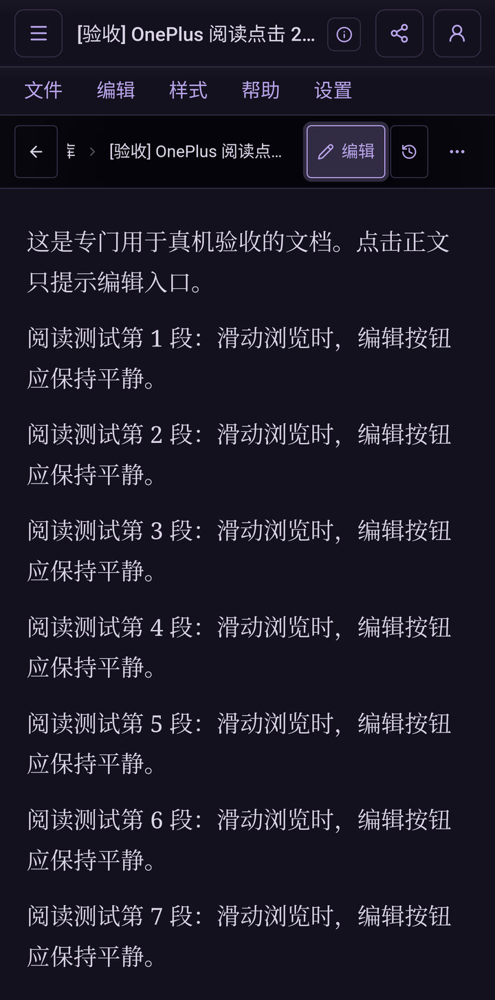

# Android 完整包与真机验收

2026-10-13 至 2026-10-14（纽约时间）在 OnePlus 7 Pro / GM1911 上完成。手机系统为 Android 13 / LineageOS，桌面为 Launcher3；不代表其他 OxygenOS 版本的验收。

## 安装包

- 源码提交：`5a5854b`，包含 `d53d3da` 的账号入口与阅读点击优化，以及本轮返回菜单修复。
- 包名：`com.vana.no_visitors.preview`；名称：Vana Preview；版本：0.7.0 / 7000；架构：arm64-v8a。
- 使用 release 优化与 R8，采用与已安装 Preview 相同的本机调试证书签名。这是测试包，不进入正式分发渠道。
- APK：`dist/android/vana-0.7.0-preview-5a5854b-arm64.apk`，同时复制到主工作区同名路径。
- SHA-256：`7d934105d5e20aa5dde48ba18356b55266f1a31792949f90016e92e611b519f2`。
- 签名校验通过，手机已安装 APK 的字节哈希与上述文件一致；使用 `adb install -r` 覆盖安装，没有卸载或清空应用数据。

本轮重新构建 Vite 静态文件及 Rust Android 原生库，再生成 APK。实际手机 WebView 加载的是此次构建的 `index-ycoAN3AH.js`，没有沿用此前只更新图标资源的旧原生库。正式 Vana 包仍独立安装。

## 结果

25 项真机交互断言通过，另完成覆盖升级、冷启动和原有内容核对：

- 顶栏账号入口打开独立账号页，原同步 / 刷新入口隐藏；账号页不展示手动同步、队列或同步时间。
- 阅读状态保持只读，没有“请先进入编辑模式”提示文本。系统触摸精确点中字符时，编辑按钮高亮并自动消退，正文不进入编辑。
- 系统触摸拖动、长按、空白点击、双击均不误触；垂直划动使正文实际滚动约 503 CSS px，期间没有高亮。通过设备 WebView 的 CDP 另检查多指与取消触摸。
- 长按能弹出复制菜单；手机返回键先关闭菜单，正文仍在当前页。此项在初次验收中发现问题，本轮已修复并重新安装验证。
- 明确点击编辑按钮后才能编辑；输入测试标记并点击保存，真实 Android 原生数据库中能读到修改。强制停止并冷启动后，测试正文仍包含该标记，能从文档库重新打开。
- 初次覆盖升级前后，8 条活动文档（包含一条新建验收文档）的标题、正文 JSON、标签摘要一致；最终另核对 7 条原有文档，摘要全部与升级前一致。
- 类型检查、30 项现有前端测试、生产前端构建通过。R8 的实际 DEX 保留分享与 Keystore JNI 方法；图标资源检查通过。

阅读高亮证据：

原始截图与结果保存在工作区 `output/device/`，未提交手机通知栏或其他应用画面。

## 测试中发生的误写与恢复

初次辅助脚本从账号页返回时选中了默认文档，误向一条原有文档插入了 `VANA_PHONE_EDIT_PRECHECK`。已在历史正文中找到与升级前摘要完全相符的内容，恢复原正文并移除标记；随后逐条核对原有文档的标题、正文 JSON 和标签摘要，全部匹配。修改记录保留此次测试写入与恢复，没有删除审计记录。

最终编辑验收脚本在输入前先核对：当前编辑器正文必须与指定验收文档的原生 JSON 一致。这里只编辑验收文档。文档保存时应用会按正文生成标题，冷启动后的重新打开测试按原生记录的实际标题定位。

## 验证范围

真实 APK、真实触摸、真实 Tauri IPC 和原生 SQLite；没有替换 IPC 或模拟原生数据库。账号部分检查页面入口与可见控件，本轮未重新执行真实登录或 Supabase 多账号同步验收。

新完整包与此前已通过 OnePlus 图标验收的资源包，其所有 `res/` 文件逐字节一致，继续包含无白边图标资源；此前 Launcher3 的实际图标对比见 [图标说明](design/APP_ICON.md)。本轮没有取得新安装后的桌面图标截图，不扩大该证据到所有 OnePlus 系统。

官网下载与 GitHub Release 分工见 [分发建议](RELEASE_DISTRIBUTION.md)。本轮保留 PR 草稿，没有创建版本标签或发布正式 Release。
