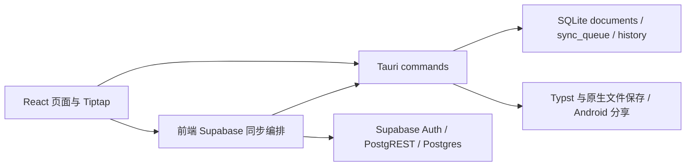

# Vana 项目信息与代码审查

> 历史设计或验收记录，仅说明当时状态。当前功能与发布结论见 [文档索引](../README.md)。
审查日期：2026-10-12（America/New_York）。范围：当前完整工作区，包括审查开始前已有的未提交 Android 分享、导出和主页改动；不是仅审查最近一次提交。未修改业务代码，未访问真实账号或向真实 Supabase 写入数据。

**结论：技术选型适合本地优先文档应用，但当前保存与同步机制尚不足以支持可靠的多设备使用。已复现正文丢失、跨文档标签串写、跨账号数据混用和数据库部分提交。建议先修复数据正确性，再增加附件、实时同步等功能。**

通过清单、配置和运行代码，确认了以下项目事实。

| 项目 | 当前事实 |
| --- | --- |
| 名称 / 版本 | Vana，package.json、Cargo.toml、tauri.conf.json 均为 0.7.0；README 仍标 0.6.0 |
| 产品 | 本地优先的个人文档应用，具备分组树、编辑、收藏、最近、回收站、标签、多主题和导出 |
| 前端 | Vite 7、React 19、严格 TypeScript、Tailwind CSS 3、Tiptap 3；src/app 目录并不表示仍使用 Next.js |
| 原生层 | Tauri 2 + Rust；commands.rs 是 IPC 入口，db.rs 实现存储与部分业务规则 |
| 本地持久化 | 应用数据目录下 vana-local/vana.db，rusqlite bundled SQLite；旧 .enc 文件仅用于兼容与导入 |
| 云端 | 前端手写 fetch 调用 Supabase Auth 与 PostgREST；Postgres documents 以 (user_id,id) 为主键并配置 RLS |
| 账号入口 | 当前页面主要使用邮箱密码登录/注册；仍保留手动导入回调会话；README 的 Magic Link 操作说明已落后 |
| 同步 | 保存后、窗口前台、联网及 90 秒轮询触发；上行按待处理队列导出，当前下行实际全量，未使用增量游标过滤 |
| 导出 | 原生 PDF 使用 Typst；DOCX 使用 docx；Markdown 使用自定义转换；Android 分享通过 JNI 调用 Java |
| 平台 | 代码明确支持 Linux / Windows / Android；未实现 macOS / iOS 支持 |
| 开发 / 构建 | npm run tauri:dev；npm run typecheck；npm run build；npm run tauri:build |
| 检查机制 | lint 实际等于 tsc --noEmit；CI 执行类型检查和 cargo check，未运行行为测试；crypto.rs 有两个已有单元测试 |
| 已预留但未完整开放 | 附件云同步、模板使用流程、SQLite 历史恢复；主线没有可用的旧 Git 同步流程 |

当前实际的数据链路：

本地优先、原生 IPC、文档结构化存储及云端 RLS 的方向合理。问题集中在跨层契约：本地库缺账号命名空间，文档修改与 outbox 缺原子性，同步缺冲突版本规则，页面刷新可以覆盖编辑草稿。增加更多 UI 组件或仅保证编译通过无法解决这些问题。

以下 8 项列为高优先级（P1），涉及数据正确性、账号边界和发布后的功能可用性。

**1. 本地库与同步队列没有账号隔离，切换账号会暴露并可能上传旧账号文档。**

定位：[db.rs:223](../../src-tauri/src/db.rs#L223)、[db.rs:710](../../src-tauri/src/db.rs#L710)、[db.rs:727](../../src-tauri/src/db.rs#L727)、[supabaseSync.ts:310](../../src/lib/supabaseSync.ts#L310)。本地 documents、tags、history、sync_queue 均没有 account/user/project 归属；退出只删除 session 配置。上行时则给导出的任何文档填入当前 session.user_id。复现：A 创建文档 → 完成一次同步 → 退出 → B 登录；B 仍能读取 A 的文档，修改后被作为 B 的待上传文档导出。A 原有未同步任务还可能在 B 登录后直接上传。云端 RLS 对各用户行生效，但不能阻止客户端将别人的本地数据以当前用户身份复制到云端。

建议：以 Supabase 项目与 user_id 确定本地数据命名空间，可选每账号独立库或全表账号键；访客数据有单独空间及明确迁移流程。账号切换必须停掉旧同步任务，并隔离会话、队列和游标。

**2. 编辑器共用一个防抖保存定时器，切换文档会丢正文或串写标签。**

定位：[Editor.tsx:55](../../src/components/Editor.tsx#L55)、[Editor.tsx:75](../../src/components/Editor.tsx#L75)、[Editor.tsx:115](../../src/components/Editor.tsx#L115)。保存回调捕获旧文档的 id/content，但在执行时读取共享的 latestTags.current。编辑 A 后，在 600ms 保存执行前切到 B 并编辑，B 的 onUpdate 会 clearTimeout，取消 A 的待保存任务；若只切换不编辑，则 A 会用 B 的标签保存。离开主页时 cleanup 也直接取消待保存任务，没有 flush。

真实 React/Tiptap 浏览器复现已确认两种结果：第一种只出现 id=b 的保存调用；第二种保存 id=a，但 tags=[tagB]。为消除机器负载对 600ms 窗口的影响，复现只控制防抖定时器，IPC 使用隔离内存假数据。

建议：保存任务捕获完整不可变快照（id、正文、标题、标签、版本），按文档管理未保存任务；切文档、导航和关闭前 flush。仅给 Editor 加 key 不够，因为卸载时当前 cleanup 仍会丢弃任务。

**3. 页面 refresh 无条件回填数据库正文，通知变化也会触发重新初始化并覆盖未保存草稿。**

定位：[page.tsx:328](../../src/app/page.tsx#L328)、[page.tsx:417](../../src/app/page.tsx#L417)、[Editor.tsx:106](../../src/components/Editor.tsx#L106)、[ToastProvider.tsx:88](../../src/components/ToastProvider.tsx#L88)。refresh 每次都 setContent(数据库正文)，Editor 再 setContent 覆盖编辑状态。Home 初始化 effect 依赖整个 toast 对象；ToastProvider 每次通知增删都创建新的 context value，导致初始化重跑。浏览器复现：A 输入 LIVE_DRAFT，保存尚未执行 → 点击导出 Markdown → 成功通知触发重新初始化；编辑器从 LIVE_DRAFTDocA 变回 DocA，期间没有保存调用。同步结束和其他元数据刷新也有同类覆盖路径。

建议：初始化只由稳定依赖触发，通知接口与通知列表分离或稳定化；列表、同步状态、当前编辑草稿分别刷新。维护 dirty/base revision，只在确认无本地草稿或接受远端变更时更新正文。

**4. 下行会覆盖尚未上传的本地修改，上行也没有并发版本条件。**

定位：[supabaseSync.ts:431](../../src/lib/supabaseSync.ts#L431)、[db.rs:1004](../../src-tauri/src/db.rs#L1004)、[db.rs:1057](../../src-tauri/src/db.rs#L1057)。同步先 pull/apply，再重新导出本地待处理任务；apply_remote_documents 仅按 updated_at 字符串比较，不检查是否存在本地未同步改动。复现：本地 offline-local-edit 尚在队列，较新远端正文进入 apply 后，本地正文变成 remote-edit，后续 export 导出的也是 remote-edit，原任务最终仍可能被标完成。已有本地历史表可能留有旧快照，但主线没有恢复入口，也没有冲突提示。

POST 上行使用无条件 merge-duplicates；两台设备都 pull 完后依次 POST，后到的旧版本仍可覆盖先到的新版本。客户端时钟偏差也会影响胜负。

建议：采用服务器 revision / 条件更新和本地 base_revision；有 dirty 数据时保留双方版本或生成冲突副本，不以设备时间作为唯一排序依据。只有服务器接受相应 revision 后才确认该任务完成。

**5. 每轮同步先 PATCH 本地目录结构，旧设备会回滚云端的新移动操作。**

定位：[supabaseSync.ts:360](../../src/lib/supabaseSync.ts#L360)、[supabaseSync.ts:399](../../src/lib/supabaseSync.ts#L399)、[db.rs:959](../../src-tauri/src/db.rs#L959)。pushLocalStructureRepair 在 pull 前对本地所有分组及嵌套节点 PATCH parent_id/depth/node_kind，无版本比较、无 dirty 判断，也不更新 updated_at。复现实际同步函数：云端文档位于 new-folder 且时间更晚，本地仍在 old-folder；请求顺序 PATCH → GET，拉回的 parent_id 已变成 old-folder。

建议：停止常态执行这种结构修复；历史补丁应作为带版本的单次迁移。正常移动走与正文相同的版本化同步规则。目录深度可由父链派生，减少冗余字段分歧。

**6. 文件夹移入回收站/恢复改变整个子树，却只给根节点写同步任务。**

定位：[db.rs:617](../../src-tauri/src/db.rs#L617)、[db.rs:1425](../../src-tauri/src/db.rs#L1425)、[db.rs:917](../../src-tauri/src/db.rs#L917)。apply_status_to_subtree 修改全部后代的 status/updated_at，但 set_document_status 只对根节点 queue_job。export 只读取队列 entity_id 对应文档，所以已同步过的子文档不会上传新状态。实际 SQLite 复现：父子都已同步后删除父文件夹，子文档本地变为 trashed，导出却只有父文件夹。另一设备的子文档仍 active，可能因父节点状态过滤而在树中消失。

建议：一个事务中修改完整子树并为所有改变的节点登记同步任务；恢复/归档同样适用。移动目录产生的后代 depth 改动也需纳入一致的处理机制。

**7. 多步数据库修改没有事务，操作失败后仍留下部分变更。**

定位：[db.rs:592](../../src-tauri/src/db.rs#L592)、[db.rs:1404](../../src-tauri/src/db.rs#L1404)，保存链路另见 [db.rs:569](../../src-tauri/src/db.rs#L569)。移动先 UPDATE 根节点并 queue_job，随后 cascade_child_depths 才验证后代最大深度。复现：带子文档的根文件夹移到 depth=6 的文件夹内，返回“最大深度为 7”，但根已迁移为 depth=7、任务已入队，子文档仍 depth=1。save_document 的正文、标签、队列与历史亦分别提交，后一步出错不能撤回前一步。

建议：先校验完整子树深度，再用同一 SQLite 事务提交 documents、tags、history、outbox；apply 远端批次同样需要明确原子性及失败恢复策略。

**8. 新 Android 分享入口通过 JNI 名称调用，但 Release 混淆规则没有保留该入口。**

定位：[commands.rs:528](../../src-tauri/src/commands.rs#L528)、[AndroidShare.java:32](../../src-tauri/gen/android/app/src/main/java/com/vana/no_visitors/AndroidShare.java#L32)、[build.gradle.kts:72](../../src-tauri/gen/android/app/build.gradle.kts#L72)、[proguard-rules.pro](../../src-tauri/gen/android/app/proguard-rules.pro)。Release 开启 isMinifyEnabled；Rust 以字符串查找 AndroidShare 类、shareExportFile 方法和 lastShareError 字段。Java/Kotlin 中只有 setActivity/clearActivity 的调用，不存在 shareExportFile 的 Java 调用；项目现有 keep 规则只保留部分 TauriActivity 方法。R8 无法从 Rust 字符串调用推断需要保留的入口，可删除或改名，导致 Release 分享失效。

建议：为该类及 JNI 访问的方法/字段添加明确 keep 规则或可靠的 @Keep，并检查 Release APK 的类/方法及真机分享。此项是静态发现；本轮未执行 Android Release 安装验证。

另有 7 项中优先级问题（P2），影响同步规模、错误反馈、存储和格式兼容。

**9. 全量 pull 未分页，超过 1000 行后较新远端文档可能一直不可见。** 定位：[supabaseSync.ts:402](../../src/lib/supabaseSync.ts#L402)、[supabase/config.toml:18](../../supabase/config.toml#L18)。只有一次 GET，无 Range/offset/page，按 updated_at 升序；仓库配置 max_rows=1000，而本地允许 5000 文档。配置不变时只能拿到最旧 1000 行，后续循环重复同一批。隔离实际函数调用已确认单个未分页请求；没有运行真实 1001 行 Supabase 场景。建议分页直到结束，并为增量游标使用服务器 revision 或 (updated_at,id) 复合游标。

**10. 同步 HTTP 失败会走 UI 的成功分支。** 定位：[supabaseSync.ts:417](../../src/lib/supabaseSync.ts#L417)、[supabaseSync.ts:447](../../src/lib/supabaseSync.ts#L447)、[page.tsx:392](../../src/app/page.tsx#L392)。非 JWT 过期的 HTTP 错误返回 finalizeSyncJobs(...false...) 的正常 Promise，调用方不检查 snapshot.last_error，直接显示 success 并输出 completed 日志。隔离 fetch 返回 permission denied 后，runSupabaseSync 正常 resolve，已确认。建议返回可区分的结果类型或抛出业务错误；异常路径也统一持久化错误状态。

**11. 搜索词直接构造正则，普通字符可能导致整页渲染异常。** 定位：[SearchModal.tsx:153](../../src/components/SearchModal.tsx#L153)。例如搜索 '['、'('、'\' 且有结果时，new RegExp 产生 SyntaxError；页面没有 ErrorBoundary。建议转义正则特殊字符或使用纯字符串分段高亮。另有搜索结果用 context 文本夹带文档 id 的旧接口，不展示实际命中片段，应改为结构化 document_id/title/snippet。

**12. SQLite 配额没有覆盖实际磁盘占用，历史和任务会无限积累。** 定位：[db.rs:1147](../../src-tauri/src/db.rs#L1147)、[db.rs:1208](../../src-tauri/src/db.rs#L1208)、[db.rs:1231](../../src-tauri/src/db.rs#L1231)、[db.rs:1111](../../src-tauri/src/db.rs#L1111)。每次正文变化都保存全量 history 和全量 queue.payload，成功同步只更新 processed_at，未清理任务；25MB 统计只计算 documents 三个字段，不含历史、任务、附件。约 1000 次 100KiB 正文保存即可额外积累约 200MiB 快照与任务正文。回收站仍计入文档数量/存储，主线也没有永久删除入口。建议规定历史保留/压缩策略、清理已处理 outbox、提供可恢复的彻底删除，并区分逻辑配额与实际磁盘用量。

**13. 云端 JSONB 与前端正文格式不一致。** 定位：[migration:7](../../supabase/migrations/202604180001_init_documents.sql#L7)、[supabaseSync.ts:318](../../src/lib/supabaseSync.ts#L318)、[supabaseSync.ts:338](../../src/lib/supabaseSync.ts#L338)。本地 content_json 是序列化字符串，上行原样传给 JSONB 列，实际存成 JSON 字符串值；若云端使用表默认值或正常 JSON 对象写入，下行 String(object) 会变成 '[object Object]'，前端 parseContent 回退为空文档。隔离函数已复现对象正文转换结果。建议线上统一使用 JSON 对象，上行 JSON.parse，下行 JSON.stringify，并兼容迁移已有字符串行与校验 Tiptap schema。

**14. 未登录时无法完成“连接验证”，输入会话也没有强制验证用户身份。** 定位：[supabaseSync.ts:264](../../src/lib/supabaseSync.ts#L264)、[supabaseSync.ts:63](../../src/lib/supabaseSync.ts#L63)、[supabaseSync.ts:132](../../src/lib/supabaseSync.ts#L132)。ensureValidSupabaseSession 在无 session 时抛错，后面的“连接成功，当前未登录”分支实际不可达，已隔离复现。fetchUserProfile 遇到 HTTP 非成功却返回空对象，允许保存未经验证、缺 user_id 的导入 session。建议先单独判断 session 是否存在；导入必须以成功的 /auth/v1/user 响应确立 user_id。

**15. 文件名未经原生层校验，Windows 导出可能失败，IPC 还允许目录越界。** 定位：[commands.rs:492](../../src-tauri/src/commands.rs#L492)、[page.tsx:626](../../src/app/page.tsx#L626)。标题作为 filename，原生层直接 PathBuf.join；冒号、问号、反斜杠及 Windows 保留名没有处理，带路径的 filename/file_type 也未限制。建议原生层接受受控扩展名，处理保留字符/设备名并验证最终路径在导出目录内。此项未在 Windows 实机验证。

除上述缺陷外，以下架构与产品边界需要明确。

**安全模型已经变化。** 当前主线 documents 正文和 Supabase session（含 refresh token）直接保存在普通 SQLite；云同步也上传明文正文。keychain.rs 实际将 Base64 主密钥写入 tauri-plugin-store 的 vault_keys.json，并非系统 Keychain/Keystore。AES-GCM 模块服务于旧 .enc 文件，不能据此称当前 SQL 主线具有“零知识加密”。旧 PRD 和源码注释仍作出这些描述。应明确当前支持的安全保障；refresh token 使用原生安全存储。若零知识仍是产品要求，需要重新设计云端正文、检索字段和密钥管理，而非仅沿用旧模块。

**主线与兼容层尚未收敛。** api.ts 同时保留新 SQL API、大量返回空值/伪成功的旧 Git API；lib.rs 注册多个已失效的 Git 命令；git.rs 未作为主线模块编译。类型仍并存 path/block 文件模型与 id/Tiptap 文档模型，搜索接口还借用 file_path/context。建议将旧导入流程隔离为明确适配器，移除主线伪成功入口，建立单一文档领域类型和清晰版本契约。

**远端树结构缺少约束与校验。** SQLite parent_id 无自引用外键，Supabase hierarchy migration 也没有父节点、深度和循环约束；apply_remote_documents 直接接受远端 parent_id/depth。两台设备独立移动目录可能形成环或孤儿节点，而 DocumentExplorerTree 只从 parent_id=null 构建树，这些节点会消失。应对远端导入批次验证完整父链、节点类型和同账号归属，定义冲突目录及孤儿节点的恢复行为。

**责任集中度过高。** page.tsx 约 1800 行，包含账号状态、同步调度、文档选择、标签、导出、移动端弹层与两套布局；db.rs 约 1500 行，混合 schema 初始化、配额、树操作、同步与历史。每次 open_db 都执行 schema 检查，export/list 又逐文档查询，存在连接与 N+1 开销。建议先用 AccountContext、DocumentRepository、EditorDraftStore、SyncService 划定边界；初始化迁移只在启动执行，连接生命周期与事务由存储层统一管理。重构优先服务于上面的数据不变量，避免只拆文件而保持原有耦合。

**Hosted 限制与自托管语义不一致。** db.rs 的 512KiB 单篇、25MiB 总量、5000 文档、300 次/5 分钟写入对访客和 self-hosted 同样执行，错误却写“Hosted 模式”。这些限制没有对应的云端强制配额，因此不能作为服务端资源保护。应按产品模式配置本地保护策略，并另行设计 Hosted 服务端限制。

**文档与功能有效性存在差距。** README 标 0.6.0，密码登录页面与 Magic Link 步骤不一致；开发指南称增量拉取，而实际代码明确全量拉取。归档状态、模板标记、历史表虽存在，主页没有完整的归档操作、模板复用或 SQLite 历史恢复入口。旧 PRD 是 Git/PAT/Next.js 设计，不能作为当前功能已实现的依据。应以当前 SQL 主线更新需求及验收表，将预留结构与用户可用功能分开描述。

本轮验证结果及其适用范围如下。

- npm run typecheck：通过。
- npm run build：通过；构建警告包括较旧 Browserslist 数据，以及约 1.04MB 主 JS 与约 0.98MB html2pdf chunk（均为压缩前）。
- Linux 原生全项目 cargo check：通过（最终命令 cargo check -j 2 --manifest-path src-tauri/Cargo.toml）；未执行原生打包或 Android/Windows 交叉构建。
- SQLite 业务复现：使用当前 db.rs 的完整副本，仅将 Tauri AppHandle/数据目录解析替换为隔离 stub，业务 SQL 与函数不变；临时 crate 四个缺陷复现用例全部命中，确认第 1、4、6、7 项缺陷。
- Supabase 同步复现：TypeScript 转译并执行当前 supabaseSync.ts，mock IPC 与 fetch；确认第 5、10、13、14 项行为，并确认第 9 项未分页请求结构。
- 浏览器复现：playwright 驱动真实 React/Tiptap，mock Tauri IPC，控制 600ms debounce；确认第 2、3 项。没有使用真实账号或实际云端。
- Android Release 混淆及 Windows 文件名问题为静态审查，未宣称实机验证。PDF 排版、DOCX 输出和真实邮件登录没有完成端到端验证。
- 项目 CI 当前不会捕获上述业务缺陷；已有 crypto 单元测试不覆盖编辑器、SQLite 树操作、账号切换或 Supabase 一致性。

临时复现材料位于 /tmp/vana-review-qwgszl1j（Rust），/tmp/vana-review-sync.cjs、/tmp/vana-review-browser.cjs、/tmp/vana-review-editor.cjs、/tmp/vana-review-refresh.cjs（前端与浏览器）。这些路径属于本轮隔离实验，不是项目新增生产模块。

建议处理顺序：先修复账号归属、保存快照与 dirty 草稿保护；再建立事务化 outbox、子树操作与带 revision 的同步协议；随后修复分页、错误反馈、Android Release 保留规则及格式契约。将已复现的场景转为 CI 回归用例后，再推进附件、实时同步与更多平台。
