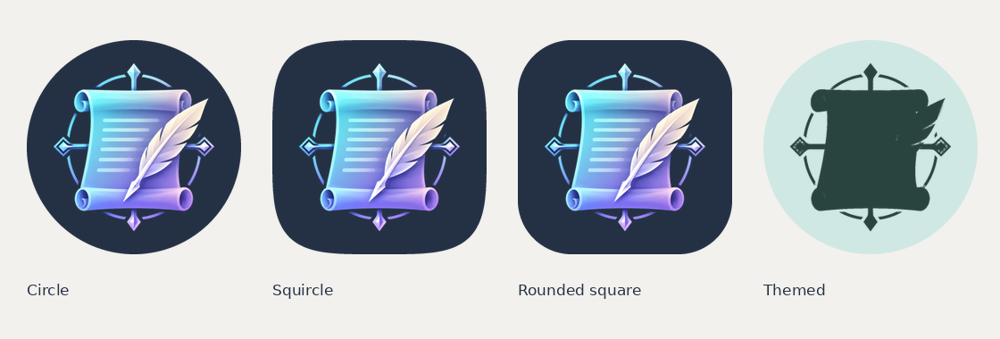
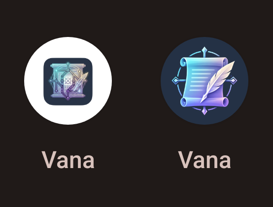

# Vana 应用图标

新图标保留原图的卷轴、羽笔、青色与紫色，移除细小符文和中央交叉标记，减少缩小后的视觉噪声。原参考图可从提交 `267f84e` 的 `public/VanaIcon.png` 取回。

## 图生图来源

- 经用户明确要求，使用 imagegen 技能的 API / CLI 模式，调用 `gpt-image-2` 的图片编辑接口；输入为旧图标，输出 1024 × 1024，质量 high，opaque。
- 完整提示词：[app-icon-prompt.txt](app-icon-prompt.txt)。API 返回原图：[vana-icon-artwork.png](../../assets/branding/vana-icon-artwork.png)。
- 模型实际返回的图案比提示词中的安全区大，背景也有轻微变化，因此没有直接将返回图片用作 Android 前景。
- 使用技能自带 `remove_chroma_key.py` 去除深色底，键色 `#1f2d46`，soft-matte 阈值 12 / 42，得到已人工检查的透明图案：[vana-icon-mark.png](../../assets/branding/vana-icon-mark.png)。
- 已选定的透明图案是后续导出的唯一输入，不需要再次调用 API。API 密钥与服务地址未写入仓库。

## Android 白边修复

旧 PNG 带有透明外边距与已绘制的圆角底，Android 项目缺少 `mipmap-anydpi-v26` 自适应定义。桌面将其按旧式图标处理，在外围补白色底并缩小图案；这已在连接的 OnePlus 7 Pro 上复现。

新资源使用完整不透明的 `#243145` 背景和独立透明前景。前景采用 108 dp 画布，图案位于直径 60 dp 的圆内，相对 Android 的 66 dp 安全圆保留余量。API 26+ 的 `icon` 与 `roundIcon` 都选取同一自适应图层，由桌面裁切形状；API 33+ 额外提供 monochrome 图层。API 24–25 使用五档密度的传统图标与圆形后备图。

已清除未使用的 Android Studio 机器人前景。桌面 PNG、Windows 多尺寸 ICO 与真正的 ICNS 一并更新，修复原导出脚本中 ICO 仅含小尺寸及 ICNS 实为 PNG 的问题。



## 可重复生成与检查

需要 Python 3 与 Pillow（`Pillow>=10,<13`）。从项目根目录运行：

```bash
python3 scripts/generate-app-icons.py
python3 scripts/check-app-icons.py
```

旧的 `src-tauri/icons/generate-icons.sh` 和 `create_icon.sh` 也转入同一生成流程。`public/VanaIcon.png` 是导出产物，替换设计应更新 `assets/branding/vana-icon-mark.png` 后重新生成；不要用 `tauri icon` 覆盖分层资源后直接发布。

检查脚本验证 manifest 的 icon / roundIcon、自适应与主题图层引用、五档像素尺寸、前景安全圆、传统图标整圈的背景色与不透明度，以及 ICO / ICNS。分支 CI、开发预览 CI 与发布前检查均运行此项检查。

## 验证范围

- `python3 scripts/check-app-icons.py`：通过。
- `npm run build`：通过。
- Python 编译、Shell 语法与 `git diff --check`：通过。
- 圆形、超椭圆、圆角方形和主题图标预览：人工检查通过。

### OnePlus 安装验收

设备为 OnePlus 7 Pro（GM1911），Android 13 / LineageOS，桌面为 `com.android.launcher3`。先在该桌面复现旧图标的白色圆底，再使用相同测试签名更新独立包 `com.vana.no_visitors.preview`，`adb install -r` 成功，未卸载或清除数据。正式包没有更新。



新图标外圈截图抽样 4,080 个像素，全部为 `(36, 49, 69)`，白色像素为 0。应用冷启动 `Status: ok`。AAPT 检查最终 APK，确认 API 26 / 33 自适应定义已打包，API 33 图标引用背景、前景及 monochrome，背景为 `#ff243145`。

此验收包通过 Gradle 编译资源、Kotlin 与 Java，并重新打包、签名，复用了已有的 arm64 原生库；仅验证图标安装与启动，不代表当前分支所有前端变化的完整原生验收。验收 APK 保存在本地 `output/imagegen/vana-icon-preview-arm64.apk`，不作为正式发布产物。

自适应图标资源遵循 Android 平台规则。实机结论覆盖上述手机当前系统与桌面，尚未在 OxygenOS 桌面上测试。
